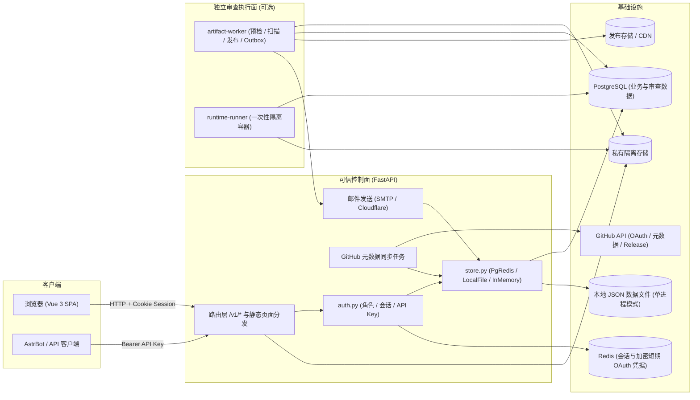

# 系统架构

AstrBot Community Plugins 是一个服务端驱动的插件市场。FastAPI 负责可信控制面（市场 API、前端静态资源托管与 AstrBot 插件源）；在完整社区模式下，独立的 `artifact-worker` 负责插件包预检、静态/恶意软件/依赖/LLM 审查、不可变对象发布和通知 outbox，独立的 `runtime-runner` 负责调度一次性隔离容器。任何插件代码都不会在 API 或 `artifact-worker` 进程中执行。

## 系统全景



仓库包含两个应用目录：

1. `apps/market-web/`：Vue 3 + Vite+（Vite Plus）+ TypeScript 前端应用，负责公开插件市场、详情与作者页、插件提交表单、审查工作台、后台设置与个人中心。生产构建输出到 `apps/market-web/dist`。
2. `apps/api/`：FastAPI 后端服务，提供身份认证、插件 CRUD、审核、评论、点赞、通知、公告、用户管理、API Key、插件包审查控制面与 AstrBot 插件源，并托管前端构建产物。

## 后端架构

后端应用代码位于 `apps/api/app/`，按职责拆分为以下模块：

| 模块 | 职责 |
| --- | --- |
| `main.py` | `create_app()` 工厂、`lifespan` 生命周期、全部市场与系统路由、前端静态文件与 404 分发、GitHub 元数据同步、邮件发送 |
| `config.py` | `Settings` 数据类、`load_settings()`、环境变量与 `.env` 合并、存储模式与安全配置解析 |
| `schemas.py` | Pydantic 2 请求体校验模型（提交、评论、安装向导、系统设置、邮件等） |
| `auth.py` | `Role` 枚举、权限检查函数（`can_edit_plugin` / `can_manage_plugin_submission` / `can_configure_plugin_cdn` 等）、PBKDF2 密码哈希、API Key 鉴权 |
| `store.py` | `InMemoryMarketStore`、`LocalFileMarketStore`、`PgRedisMarketStore` 与 PostgreSQL 基础建表 SQL |
| `cdn.py` | 按插件可选 CDN 订阅状态、版本代次管理与自动送审队列 |
| `github_authorization.py` | 用户 GitHub OAuth 仓库管理权限核验、Fernet 加密凭据读写与发布前仓库身份复核 |
| `plugin_identity.py` | 插件命名空间冲突异常与规范详情路径（`/plugin/{owner}/{name}`）生成 |
| `openapi_filter.py` / `llms_txt.py` | 按当前登录角色过滤 `/openapi.json`（含 `components` 闭包）与生成 `/llms.txt` |
| `env_file.py` | `.env` 文件解析与写回工具（供一次性 `/v1/setup` 使用） |
| `schema_migrations.py` / `migrations/` | 带 SHA-256 checksum 校验与 PostgreSQL advisory lock 的版本化数据库迁移 |
| `artifacts/` | 不可变插件包状态机、存储抽象、预检、静态/恶意软件/依赖/LLM 审查、人工复核、发布、通知与独立 `artifact-worker` |
| `runtime_runner/` | 独立 `runtime-runner` 服务、Docker 执行器、受限安装网络校验与一次性探针入口 |

### 启动与生命周期

模块级 `app = create_app()` 完成 FastAPI 实例装配：

```text
create_app(settings, store)
  ├── FastAPI(lifespan=lifespan, docs_url=None, redoc_url=None, openapi_url=None)
  ├── app.state.settings = settings or load_settings()
  ├── app.state.store = store or create_store(settings)
  ├── app.state.artifact_runtime = build_artifact_runtime(...)
  ├── 注册 CORS 与 Cache-Control 中间件
  ├── 注册异常处理器（HTTPException / PluginIdentityConflict / GithubIdentityConflict）
  ├── register_routes(app) + include_router(build_artifact_router())
  └── register_market_web_routes(app)
```

`lifespan` 负责管理启动与关闭顺序：

- **API 启动**：执行 `store.connect()`（PostgreSQL 模式下同步执行版本化迁移，本地模式下加载或初始化 JSON 文件并清理过期会话）→ 初始化 artifact 控制面组件（不启动进程内审查循环）→ 引导或加载核心管理员账号 → 启动后台 GitHub 元数据同步任务。
- **独立 Worker**：`python -m app.artifacts.worker` 通过 PostgreSQL lease 与 `FOR UPDATE SKIP LOCKED` 领取待处理任务；租约超时后可由其他实例接管。
- **优雅关闭**：API 取消元数据同步任务并关闭 artifact 运行时与存储连接；Worker 停止领取新任务并释放连接。

### 存储模式与热切换

`create_store()`（位于 `apps/api/app/main.py`）按配置选择存储后端：

- `MARKET_STORAGE_MODE=local`：`LocalFileMarketStore`，单进程线程锁保护，以临时文件 `fsync` + `os.replace` 原子写入单个 JSON 文件，持久化所有市场数据与带 TTL 的会话，无需 PostgreSQL 和 Redis。
- `MARKET_STORAGE_MODE=postgres`（默认）且同时配置 `DATABASE_URL` 与 `REDIS_URL`：`PgRedisMarketStore`，PostgreSQL 存业务数据，Redis 存会话和加密短期 OAuth 凭据。
- `MARKET_STORAGE_MODE=postgres` 且缺少数据库连接：回退 `InMemoryMarketStore`（不持久化），仅用于开发调试或首次打开 `/setup`。

通过 `/v1/setup` 完成首次初始化后，后端调用 `activate_setup_store()` 在当前进程内热切换至持久化存储，无需重启服务。

## 数据模型

### PostgreSQL

基础业务表（10 张）定义于 `store.py`：

| 表 | 主键 | 核心字段与约束 |
| --- | --- | --- |
| `market_users` | `id` | `github_id`（UNIQUE）、大小写不敏感 `github_login` / `internal_username` 唯一索引、`password_hash`、`auth_source`、`github_token`、`role`（`core_admin` / `admin` / `user`）、禁言字段 |
| `market_plugins` | `id` | `repo`（UNIQUE）、`(owner_user_id, name)`、大小写不敏感 `(owner_github_login, name)` 与 `(author, name)` 唯一索引、`display_name`、`desc_text`、`tags`（`jsonb` + GIN 索引）、`status`（`pending` / `listed` / `unlisted`）、`stars`、`likes`、`comments_count`、`metadata`（`jsonb`） |
| `market_submissions` | `id` | `plugin_id`（FK CASCADE）、`user_id`（FK CASCADE）、`payload`（`jsonb`）、`status` |
| `market_comments` | `id` | `plugin_id`（FK）、`user_id`（FK）、`parent_id`（自引用 FK，支持嵌套）、`body`、`likes`、`deleted`、`deleted_by` / `deleted_at`；有效评论部分索引 `WHERE deleted = false` |
| `market_plugin_likes` | `(plugin_id, user_id)` | 联合主键，保证每用户对同一插件仅能点赞一次 |
| `market_comment_likes` | `(comment_id, user_id)` | 联合主键，保证每用户对同一评论仅能点赞一次 |
| `market_announcements` | `id` | `title`、`body`、`author_user_id`（FK） |
| `market_notifications` | `id` | `user_id`（FK）、`type`、`title`、`body`、`metadata`（`jsonb`）、`dedupe_key`（可选唯一去重键）、`read` |
| `market_api_keys` | `id` | `name`、`user_id`（FK）、`scopes`（`jsonb`）、`key`（UNIQUE） |
| `market_options` | `option_key` | `option_value`，存储运行时站点、OAuth、市场策略与邮件配置 |

版本化迁移另建插件包与审查体系表，包括 `plugin_artifacts`、`artifact_files`、`review_runs`、`review_findings`、`review_decisions`、`review_comments`、`review_policies`、`plugin_cdn_subscriptions`、`artifact_jobs`、`outbox_events` 与 `market_schema_migrations`。`market_plugins.repo_version` 随仓库元数据更新，`current_artifact_id` 仅由发布或下架事务更新。历史迁移脚本的 checksum 一旦被篡改，服务将拒绝启动。

关键不变式包括：`(plugin_id, archive_sha256)` 幂等、已发布 `(plugin_id, normalized_version)` 唯一、隔离与发布对象 key 唯一、人工决策与任务 `idempotency_key` 唯一。发布事务提交前会再次锁定插件与 artifact 记录，并校验仓库版本与 CDN 开关。

### Redis

仅在 `PgRedisMarketStore` 中使用，存储两类带 TTL 的短期数据：

- **登录会话**：Key 为 `astrbot_market:session:{token}`，Value 为 JSON 序列化的 `{token, user_id, created_at, last_seen_at}`；TTL 由 `SESSION_MAX_AGE_SECONDS` 控制（默认 7 天），读取时自动续期。
- **加密短期 GitHub OAuth 授权凭据**：用于仓库管理权限校验，使用由 `GITHUB_CLIENT_SECRET` 经 HKDF 派生的 Fernet 密钥加密，TTL 不超过 8 小时，注销或会话失效时同步删除。

### 本地单文件与内存存储

`InMemoryMarketStore` 使用内存字典维护 `users`、`plugins`、`submissions`、`comments`、`pluginLikes`、`commentLikes`、`announcements`、`notifications`、`apiKeys`、`options`、`sessions` 与 `nextNumericId`。`LocalFileMarketStore` 在其基础上增加线程锁、会话过期清理与原子 JSON 文件持久化。

## API 端点概览

所有业务路由统一位于 `/v1/*`（AstrBot 插件源、健康检查、文档契约与前端静态页面除外）。完整契约以运行时生成的 `/openapi.json` 为准（按当前登录角色动态过滤），`/docs/rest` 提供内置可视化文档与在线试用；FastAPI 原生 `/docs` 与 `/redoc` 已关闭并返回 404。

### 公开端点（无需登录）

| 方法 | 路径 | 说明 |
| --- | --- | --- |
| `GET` | `/health` | 健康检查（包含 `storage_mode`、`setup`、存储与 artifact 状态） |
| `GET` | `/v1/site` | 公开站点配置（名称、图标、认证与市场开关、`setup_required`） |
| `GET` | `/v1/setup/status` | 首次安装状态（脱敏；初始化完成后返回 404） |
| `POST` | `/v1/setup` | 提交首次初始化配置并热切换存储（初始化完成后返回 404） |
| `GET` | `/v1/plugins` | 已上架插件列表（`status=listed`） |
| `GET` | `/v1/plugins/by-author/{username}/{name}` | 按作者用户名与插件名获取已上架插件详情 |
| `GET` | `/v1/plugins/{id}` | 按插件 ID 获取详情（含评论树与点赞状态） |
| `GET` | `/v1/plugins/{id}/readme` | 获取插件 README 缓存或实时内容 |
| `GET` | `/v1/authors` | 获取公开作者名及是否有已上架插件 |
| `GET` | `/v1/authors/{username}/plugins` | 获取指定作者的已上架插件列表 |
| `GET` | `/v1/announcements` | 公告列表 |
| `GET` | `/plugins.json` · `/plugins-md5.json` | AstrBot 插件源 Feed 与 MD5 摘要 |
| `GET` | `/v1/astrbot/plugins(.json\|-md5.json)` | 带 `v1` 前缀的等价 AstrBot 插件源端点 |
| `GET` | `/openapi.json` · `/llms.txt` | 按当前角色过滤的 OpenAPI 契约与 LLM 端点索引 |

### 认证端点

| 方法 | 路径 | 说明 |
| --- | --- | --- |
| `POST` | `/v1/auth/internal/login` | 用户名或邮箱 + 密码登录 |
| `POST` | `/v1/auth/email/register` | 邮箱一步直通注册（仅 `EMAIL_VERIFICATION_REQUIRED=false` 时开放） |
| `POST` | `/v1/auth/email/register/request` · `verify` | 邮箱两步验证码注册（`EMAIL_VERIFICATION_REQUIRED=true` 时开放） |
| `POST` | `/v1/auth/email/password-reset/request` · `verify` | 邮箱验证码找回与重置密码（成功后吊销旧会话） |
| `GET` | `/v1/auth/github/login` | 跳转至 GitHub OAuth 授权页（支持游客登录/注册与已登录账号绑定） |
| `GET` | `/v1/auth/github/callback` | OAuth 回调，创建会话并写入 `market_oauth_identities` 及短期仓库授权凭据 |
| `POST` | `/v1/auth/logout` | 注销登录并清除服务端会话与短期 OAuth 凭据 |
| `GET` | `/v1/auth/session` | 查询当前会话状态与五级身份信息 |
| `GET` | `/v1/auth/debug-login` | 开发调试登录（仅 `ENABLE_DEV_AUTH=true` 时可用） |

### 当前用户（需登录）

| 方法 | 路径 | 说明 |
| --- | --- | --- |
| `GET` / `PATCH` | `/v1/me` · `/v1/me/profile` | 获取当前用户信息（含 `account_tier`、OAuth 绑定列表）/ 更新资料与通知偏好 |
| `POST` | `/v1/me/password` | 修改本地密码或 OAuth 用户首次设置本地密码 |
| `POST` | `/v1/me/email/change/request` · `verify` | 修改或绑定登录邮箱（随 `EMAIL_VERIFICATION_REQUIRED` 开关决定是否需验证码） |
| `GET` / `DELETE` | `/v1/me/oauth-identities[/{id}]` | 查看或解绑已绑定的 OAuth 身份（保留防锁死保护） |
| `GET` | `/v1/me/plugins` | 我的插件列表（开发者及以上在 OpenAPI/llms 中可见） |
| `GET` | `/v1/me/github/repositories` | 列出当前 OAuth 会话可管理的公开 `astrbot_plugin_*` 仓库 |
| `GET` / `POST` / `DELETE` | `/v1/me/api-keys[/{id}]` | 个人 API Key 管理（注册用户仅只读，开发者及以上可创建写入 Key） |
| `GET` / `POST` / `DELETE` | `/v1/me/notifications[/{id}]` | 通知分页查询、未读计数、标记已读与单条/批量/清空删除 |

### 插件提交与互动（需登录）

| 方法 | 路径 | 说明 |
| --- | --- | --- |
| `POST` | `/v1/plugins/submissions/metadata-preview` | 核验仓库权限后从 GitHub 预取 `metadata.yaml` |
| `POST` | `/v1/plugins/submissions` | 提交新插件或更新已有插件 |
| `PATCH` | `/v1/plugins/{id}` | 编辑插件元数据（所有者或管理员） |
| `PATCH` | `/v1/plugins/{id}/cdn` | 开启或关闭插件社区源 CDN（核心管理员或所有者） |
| `POST` | `/v1/plugins/{id}/request-list` · `unlist` | 申请上架 / 自主下架（所有者） |
| `POST` | `/v1/plugins/{id}/refresh-github` · `readme/refresh` | 手动刷新仓库元数据或 README 缓存 |
| `POST` | `/v1/plugins/{id}/like` · `unlike` | 插件点赞 / 取消点赞 |
| `POST` | `/v1/plugins/{id}/comments` | 发表或回复评论 |
| `POST` / `DELETE` | `/v1/comments/{id}[/like\|/unlike]` | 评论点赞 / 取消点赞 / 删除（作者或管理员） |

### 管理员（`admin` 及以上）

| 方法 | 路径 | 说明 |
| --- | --- | --- |
| `GET` | `/v1/admin/check` · `/v1/permissions` | 查询当前用户管理权限与功能权限位 |
| `GET` | `/v1/admin/summary` · `/v1/admin/plugins` · `/v1/plugins/submissions` | 后台统计摘要、全部插件与待审提交列表 |
| `POST` | `/v1/admin/plugins/{id}/list` · `unlist` | 审核上架 / 填写理由下架并通知所有者 |
| `POST` | `/v1/admin/plugins/{id}/refresh-github` | 触发仓库元数据刷新 |
| `DELETE` | `/v1/admin/comments/{id}` | 删除任意评论 |
| `GET` / `POST` | `/v1/admin/users` · `/v1/admin/users/{id}/mute` · `unmute` | 查看用户列表 / 禁言与解禁 |
| `GET` / `POST` | `/v1/api-keys` | 列出或颁发全局 API Key |

> [!NOTE]
> 插件包上传、审查工作台、版本评论、人工放行/重跑、审查策略管理与工具健康度端点由 `apps/api/app/artifacts/routes.py` 注册，具体操作流程见 [plugin-review-operations.md](plugin-review-operations.md)。

### 核心管理员（`core_admin`）

| 方法 | 路径 | 说明 |
| --- | --- | --- |
| `GET` / `PUT` | `/v1/admin/settings` | 读取与更新运行时系统设置（密钥字段脱敏保留） |
| `POST` | `/v1/admin/settings/github-tokens/verify` · `email/test` | 验证 GitHub API Token 池 / 发送测试邮件 |
| `GET` | `/v1/admin/setup/status` | 查询初始化与基础设施状态 |
| `POST` / `DELETE` | `/v1/core/users[/{id}]` | 创建或删除内部用户 |
| `POST` | `/v1/core/admins/{id}` | 调整普通用户与管理员角色 |
| `POST` | `/v1/core/announcements` | 发布全站公告 |

### 前端静态文件与 404 分发

`/` 与 `/{full_path:path}` 由 `register_market_web_routes` 处理：优先匹配 `apps/market-web/dist` 中的静态资源或预渲染 HTML（如 `/plugin/{username}/{name}/index.html`），已知前端路由回退到 `index.html`，保留 API 路径不参与前端回退，**未知路径返回真实 HTTP 404**，并按路径分类附加明确的 `Cache-Control` 响应头。

## 认证与权限模型

### 五级身份与能力矩阵

数据库 `market_users.role` 仅保存管理层级（`user` / `admin` / `core_admin`），`developer` 按有效 OAuth 绑定或存量上架/待审插件实时推导：

| 能力 | `core_admin` | `admin` | `developer` | `user` | `guest` |
| --- | :---: | :---: | :---: | :---: | :---: |
| 管理系统设置、认证/验证开关、邮件与审查策略 | 支持 | — | — | — | — |
| 管理管理员队伍、创建/删除本地用户、发布公告 | 支持 | — | — | — | — |
| 审核上架/下架、审查插件包、删除任意评论、禁言用户 | 支持 | 支持 | — | — | — |
| 管理任意插件 CDN | 支持 | 仅自有插件 | 仅自有插件 | — | — |
| 提交插件、修改仓库、上传制品、创建 `market:write` API Key | 支持 | 支持 | 需有效 OAuth（存量自下架/关 CDN 除外） | — | — |
| 评论、点赞、回复、站内信、创建 `market:read` API Key | 支持 | 支持 | 支持 | 支持 | — |
| 浏览插件、详情、作者页与插件源 | 支持 | 支持 | 支持 | 支持 | 支持 |

核心权限函数定义在 `apps/api/app/auth.py` 与 `apps/api/app/oauth_identities.py`。

### 登录与注册方式

1. **邮箱注册与密码登录**：受 `EMAIL_REGISTRATION_ENABLED` 与 `EMAIL_VERIFICATION_REQUIRED` 控制，支持验证码两步注册与免验证直通注册；通过 `/v1/auth/internal/login` 支持用户名或邮箱配合 PBKDF2-SHA256 密码登录；忘记密码可通过邮件验证码重置并递增 `session_version` 吊销全部旧会话。
2. **GitHub OAuth**：访问 `/v1/auth/github/login` 完成授权后回到 `/v1/auth/github/callback`，游客可直接登录/注册，已登录用户则非破坏性绑定到 `market_oauth_identities` 并升级为开发者；若用户属于 `GITHUB_ADMIN_ORG` 且当前非管理员，则自动提权为 `admin`。
3. **开发调试**：仅当 `ENABLE_DEV_AUTH=true` 时开放 `/v1/auth/debug-login`，通过 `X-Dev-GitHub-Login` 请求头快速模拟登录，生产环境必须关闭。

会话基于 `HttpOnly` Cookie（`astrbot_market_session`，非 JWT），Token 格式为 `sess_{token_urlsafe(24)}`，可在服务端即时吊销。详细安全机制见 [security.md](security.md)。

## 关键机制

### 双层配置模型

- **静态环境层**：`.env` 与系统环境变量承载基础设施连接（`DATABASE_URL`、`REDIS_URL`、`MARKET_STORAGE_MODE`、`LOCAL_DATA_PATH`）、密钥（如 `GITHUB_CLIENT_SECRET`）和启动期安全开关（`ENABLE_DEV_AUTH`、`COOKIE_SECURE`）。
- **运行时配置层**：站点展示、GitHub OAuth 公开参数、市场功能开关与邮件参数保存在持久化配置表（`market_options` / 本地 `options`）中，由核心管理员通过 `/v1/admin/settings` 热更新，并通过 `runtime_settings_for_app()` 覆盖环境层同名项，无需重启进程。

### 首次启动热切换

- **完整模式**：`/v1/setup` 依次连接 PostgreSQL（目标库不存在时自动建库）、执行表结构迁移、验证 Redis、写入核心管理员；所有步骤成功后才写入 `.env`，并通过 `activate_setup_store()` 在进程内切换存储，随后关闭 `/v1/setup`。
- **本地单进程模式**：`/v1/setup` 只需校验站点信息与核心管理员账号，写入本地数据文件与 `.env` 后立即生效；也可通过 `CORE_ADMIN_USERNAME` + `CORE_ADMIN_PASSWORD` 在启动时免向导初始化。

### GitHub 元数据同步

- 后台任务周期性抓取已上架插件的星标、README 与版本信息，将版本写入 `market_plugins.repo_version`（不信任仓库自填的 `download_url`）。
- `GITHUB_API_TOKEN` 支持逗号、分号或换行分隔多个 Token，通过轮转缓解 GitHub API 速率限制；触发限流时显式向上游报错。
- 插件所有者可携带临时 Token 手动刷新自有插件（`/v1/plugins/{id}/refresh-github`），管理员可刷新任意插件。

### 通知与 Outbox 投递

- 评论回复、插件点赞和评论点赞直接写入站内通知。
- 插件包审查状态变更与 policy activate/retire/rollback 生命周期事件在同一数据库事务中写入 `outbox_events`，再由独立 `artifact-worker` 以 lease 机制异步领取并投递站内通知与可选邮件。
- 站内通知使用 `dedupe_key` 唯一约束保证不重复创建；外部 SMTP/Cloudflare 邮件按 at-least-once 语义投递，邮件异常不会回滚或阻塞审查与发布状态。
- 邮件正文严格由事件类型白名单模板渲染，仅包含插件或策略名称、版本、固定状态、工作台链接，以及批准通知中经过脱敏与长度限制的管理员评价；不附带源码、diff、扫描证据、日志或内部对象路径。
- 管理员下架当前已发布版本时，决策记录、`revoking` 状态、将插件移出公开 Feed 与删除公开对象的 `revoke` 任务在同一事务中提交；若对象删除失败，状态进入 `revoke_failed` 且 Feed 保持隐藏，支持后续重试。

### API Key

- **全局静态 Key**：由 `MARKET_API_KEYS` 环境变量定义，格式为 `name:key:scope1|scope2`。
- **管理员颁发 Key**：由管理员通过 `POST /v1/api-keys` 动态签发，带 `sk-ah-` 前缀。
- **个人 Key**：登录用户通过 `/v1/me/api-keys` 自建与撤销，带 `sk-ah-` 前缀。
- 请求通过 `Authorization: Bearer <key>` 鉴权并按 `scopes` 校验。明文仅在创建响应中返回一次，列表接口只返回元信息。

### 邮件服务

由 `EMAIL_PROVIDER` 决定发送通道：

- `disabled`（默认）：关闭邮件发送，测试发送返回 400。
- `smtp`：基于 `aiosmtplib`，默认自动协商加密与认证方式，也可显式指定 `STARTTLS`、`SSL/TLS`、明文以及 `AUTH LOGIN` / `AUTH PLAIN`。
- `cloudflare`：调用 Cloudflare Email Sending API 发送邮件。

每日发送总量受 `EMAIL_DAILY_LIMIT` 限制，单邮箱每日验证码受 `EMAIL_VERIFICATION_DAILY_LIMIT_PER_USER` 限制（均写入 Redis / 本地共享存储），详见 [security.md](security.md)。

## 前端架构

`apps/market-web` 基于 Vue 3.5、Vite+（Vite Plus）与 TypeScript（Composition API + `<script setup lang="ts">`）构建：

| 模块 | 技术选型 |
| --- | --- |
| 构建与校验 | Vite+（`vp dev` / `vp build` / `vp check` / `vp test --run`），配置见 `apps/market-web/vite.config.ts` |
| UI 组件 | Naive UI 2.43 与 `@vicons/ionicons5` 图标 |
| 路由与 SEO | Vue Router 4（`createWebHistory`）、`@unhead/vue` 与后端运行时 HTML 注入（`apps/api/app/seo_render.py`） |
| 状态管理 | Pinia 3：`stores/plugins.ts`（市场域）、`stores/artifacts.ts`（插件包）、`stores/reviewWorkspace.ts`（审查工作台）、`stores/reviewPolicy.ts`（策略管理） |
| 网络请求 | 原生 `fetch`（统一携带 `credentials: "include"`） |
| Markdown 与文档 | `marked` + `marked-alert` + `DOMPurify` + `highlight.js`、`vue-api-playground` |

### 路由与守卫

| 路径 | 视图组件 | 说明 |
| --- | --- | --- |
| `/` | `Home.vue` | 插件市场首页（支持分页与瀑布流切换、筛选与排序） |
| `/plugin/:username/:name` | `PluginDetailsPage.vue` | 规范插件详情页（含运行时与客户端 SEO、JSON-LD、README 与评论；大小写或历史登录名别名 301 重定向） |
| `/author/:username` | `AuthorPage.vue` | 作者公开插件页（大小写或历史登录名别名 301 重定向） |
| `/submit` | `SubmitPlugin.vue` | 插件提交页（社区模式走 GitHub 仓库选择，本地模式支持管理员直填 URL） |
| `/setup` | `Setup.vue` | 首次安装向导（`noindex,nofollow`） |
| `/admin` | `AdminLogin.vue` | 内部管理员登录页（`noindex,nofollow`） |
| `/admin/settings` | `Settings.vue` | 核心管理员系统设置页（`/settings` 重定向至此，`noindex,nofollow`） |
| `/settings/personal` | `PersonalSettings.vue` | 个人设置、个人插件管理与 API Key（`noindex,nofollow`） |
| `/notifications` | `Notifications.vue` | 站内通知中心（`noindex,nofollow`） |
| `/plugin-workbench` | `PluginWorkbench.vue` | 插件版本历史与审查工作台（`/admin/plugins` 重定向至此，需登录，`noindex,nofollow`） |
| `/docs/rest` | `RestDocs.vue` | REST API 文档与在线试用页 |
| `/:pathMatch(.*)*` | `NotFound.vue` | 404 页面（`noindex,nofollow`） |

`/plugin-workbench` 通过 `meta.requiresAuth` 与异步 `beforeEach` 守卫拦截未登录访问；`App.vue` 负责在初始化未完成时跳转到 `/setup`。所有权限判断最终由后端逐端点强制校验。API 基础地址由 `stores/plugins.ts` 统一解析，其他 Pinia store 直接复用。

### 关键组件

- 公共与市场视图：`AppHeader`、`AppFooter`、`PluginCard`、`PluginDetails`（含站内 README 渲染与仓库文件导航）、`PluginComment`、`SearchToolbar`、`AppPagination`、`ThemeModeButton`、`IrisMask`。
- 个人与后台设置（`components/settings/`）：`AccessKeyManager`、`AdminUserManagement`、`NotificationPreferencesSection`、`PersonalPluginManager`、`ProfileAccountSection`。
- 审查工作台（`components/workbench/`）：`ArtifactSubmissionPanel`、`PluginReviewWorkspace`、`ReviewSummaryPanel`、`ReviewFileBrowser`、`ReviewDiffViewer`、`ReviewCommentThread`、`ReviewManualPanel`、`ReviewDecisionPanel`、`ReviewHistoryTimeline`、`ReviewPolicyPanel`。

### 构建与运行时 SEO 注入

根目录 `package.json` 提供 `dev:web`、`build:web`、`dev:api`、`start:api`、`start:runtime-runner`、`test` 等快捷脚本。执行 `npm run build:web` 仅运行 `vp build` 输出标准前端静态产物，产物 `dist/index.html` 保留 `<!-- SSR_HEAD_START -->`、`<!-- SSR_HEAD_END -->` 与 `<!-- SSR_BODY -->` 占位标记。

FastAPI 进程（`apps/api/app/seo_render.py`）在请求期实时基于运行期 `WEB_URL` 与站点配置向模板注入页面 `<head>` 元数据、JSON-LD 与轻量语义 `#app` 骨架，并动态生成 `/sitemap.xml`（仅收录静态公开页、已上架插件和拥有已上架插件的作者，带 60 秒短缓存与写路径主动失效）和 `/robots.txt`，支持弱 `ETag`／`304` 协商缓存与 `GET`／`HEAD`。

## 部署架构

API 进程默认监听 `:8787`，按路径统一分发：

- `/` 及已注册页面路径 → FastAPI 运行时注入 SEO 元数据与语义骨架的 `apps/market-web/dist/index.html`（未知路径与旧 2 段 `/plugin/{id}` 返回真实 HTTP 404）
- `/sitemap.xml`、`/robots.txt` → FastAPI 动态生成的站点地图与爬虫声明（`public, max-age=3600`）
- `/assets/...` → 长期强缓存指纹静态资源（`public, max-age=31536000, immutable`）；`dist/` 根目录非指纹公开资源（`/og-cover.png`、`/logo.webp`、`/font/*` 等）使用 `public, max-age=3600`
- `/plugins.json`、`/plugins-md5.json`、`/v1/astrbot/...` → AstrBot 插件源
- `/v1/...` → 市场与审查 REST API
- `/openapi.json`、`/llms.txt`、`/docs/rest` → 角色过滤契约与内置 API 文档

支持的部署形态：

- **本地自用单进程版（`docker-compose-local.yml`）**：单容器运行 `app`，挂载单一数据卷持久化 `market-state.json` 与 `.env`，无需 PostgreSQL、Redis 与审核 Worker。
- **完整社区版（`docker-compose.yml`）**：默认启动 `app`、`postgres` 与 `redis`；按需通过 `--profile artifacts` 启动 `artifact-worker`，通过 `--profile runtime-runner` 启动独立 `runtime-runner` 与受限包代理。API 与 Worker 均不挂载 Docker socket。
- **裸机 systemd（`deploy/systemd/`）**：API、Worker 与 Runtime Runner 使用三个隔离的系统用户、独立 env 文件与最小文件权限，Runner 不持有 Redis、OAuth、LLM、邮件或对象存储凭据。

GitHub Actions（`.github/workflows/ci.yml`）仅按变更代码路径运行质量检查，不包含自动部署步骤。

## AstrBot 集成

AstrBot 客户端通过 `/plugins.json`（及等价 `/v1/astrbot/plugins(.json)` 与 `*-md5.json`）消费插件列表。Feed 遵循 AstrBot `2026-06-27` 规范（Schema Version 1），顶层包含 `$meta` 市场元数据并以 `${author}/${name}` 作为插件键，不输出客户端保留字段 `market_plugin_id`。条目保留仓库地址 `repo`，`version` 优先同步仓库的 `repo_version`（未同步时为空字符串，不虚构默认版本号），GitHub 同步还会采集根目录的 `logo.png`、README 与 CHANGELOG 的 HTTPS raw 地址（`readme_url`、`changelog_url`）以及 `.astrbot-plugin/i18n/<locale>.json` 中的 `metadata` 翻译。仅当当前已发布 artifact 的规范化版本与 `repo_version` 一致时才输出 HTTPS CDN `download_url`；否则省略 `download_url`，客户端仍可通过 GitHub 直连安装，旧的稳定 CDN 对象也不会被未过审的新版本覆盖或冒充。
